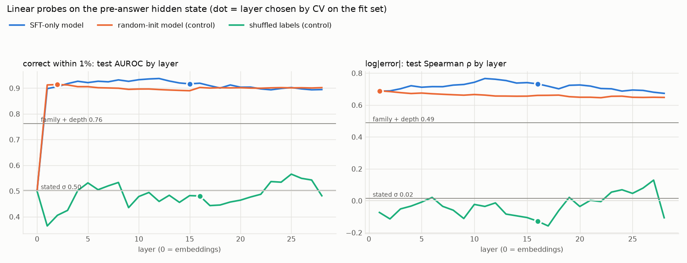

# Report: 2026-10-14 (Phase 9.5 steps 1–3 + Phase 10 step 2), and what tonight's run should be

**Short version.** All five items are done, in order, each committed and pushed. **286 tests pass. Nothing is
BLOCKED.** GPU work ended at 10:53 IST. The split-credit long run was not started, per your brief; it is ready to
launch tonight with two commands (§6).

1. **CLAUDE.md** now has phases 9.5–15 (the old Phase 10 README is Phase 15). **PREREGISTRATION.md** was committed at
   `f601bb7`, before any new result. It pre-registers families P (probe), S (split credit) and H (H1–H5), with Holm
   correction within each family.
2. **Monitoring (9.5.1):** training now logs the σ = 0 share every step and raises an alert when the 25-step rolling
   share exceeds 50% (alert only, never acts). Every eval report now carries the standing post-hoc baseline.
3. **Probe (9.5.2, FINDINGS #7): honest negative.** A linear probe on the SFT-only model's pre-answer hidden state
   predicts correctness at AUROC **0.917**, while stated σ is at chance (**0.50**). But the pre-registered random-init
   control does just as well (**0.914**, p = 0.40), so by the pre-registered rule P1–P3 are **uninterpretable**.
   Exploratory follow-ups show why:
   - A bag-of-words model on the completion text gets **0.906**.
   - Chain-template identity alone gets **0.88** (ID split).

   The information is in what the model wrote (which chain and formulas), not demonstrably in learned knowledge
   of its own error.
4. **Rounding audit (10.2, FINDINGS #8):**
   - Ground truth already uses exactly the displayed givens (difference 0.0 on all 400 eval problems), so σ\* = 0
     as defined.
   - Counterfactually, if the 3-s.f. givens were measurements, σ\* would be **0.26%** (median), a quarter of the 1%
     band.
   - A perfect 4-s.f. solver errs by **0.014%**. That matches the observed "exactly right" error spike.
5. **Split-credit trainer (9.5.3):**
   - Built and tested; tests check every property you specified.
   - **Smoke test, 10 steps:** 40.0 s/step (40.1 vs 43.0 for the uniform-credit run's same steps), peak torch
     reserved **6.46 GiB**, 0 OOMs, tape replays exactly.
   - One real bug was found and fixed: Unsloth repacks the padding in each micro-batch (D46).

---

## 1. What ran (IST)

| time | step | commit |
|---|---|---|
| 09:18–09:20 | CLAUDE.md merge (D43) | `6078e06` |
| 09:20–09:21 | PREREGISTRATION.md, before any result | `f601bb7` |
| 09:21–09:26 | 9.5.1 monitoring (D44) | `03c2c7d` |
| 09:22–10:01 | GPU: 1,600 more SFT-only completions on calibration-split seeds (probe fit set) | (data, in `b662ab6`) |
| 10:15–10:25 | GPU: hidden states, every layer, SFT-only + random-init model | (local, gitignored) |
| 10:26–10:39 | CPU: probes, controls, bootstrap; exploratory baselines | `7397f31`, `b662ab6` |
| 09:27–09:32 | CPU: rounding audit (computed while the GPU was busy; committed at 10:42, after #7) | `f58eb20` |
| 10:42–10:53 | GPU: split-credit smoke test (attempt 1 crashed at step 1, fixed, attempt 2 passed) | `4b07591` |
| 10:53–11:00 | Tonight-run tooling (written before any split-credit result), PROGRESS, this report | `f1926b0`, `439f1c4`, … |

## 2. Monitoring (Phase 9.5.1, D44)

- **Training:** `train_metrics.jsonl` gains `sigma_zero_share`, the rolling share and `sigma_zero_alert`.
  - Crossing 50% over 25 steps prints an `ALERT` line to the console and `events.jsonl`.
  - Settings are in `configs/monitor.yaml`.
  - Replayed on the Oct-13 run, the alert fires at step 474 (rolling share 51%) and never clears.
- **Eval:** every `metrics.json` / `summary.md` gains `sigma_zero_rate` and a "Standing calibration baseline" table.
  It shows this model's σ, this model's σ × 18.1, and, on the same frozen split, SFT-only and SFT-only × 18.1 (the
  baseline).
  - Example, step-287 uniform-credit RL, ID split: 1σ coverage 14.0% → 32.0% after × 18.1, against the baseline's
    35.0%.

## 3. Probe (Phase 9.5.2, FINDINGS #7)

Fit set: 1,996 SFT-only completions on training seeds. Test set: the 400 frozen eval completions. Layer and
regularization are chosen by 5-fold CV on the fit set only.

| predictor | correct ≤1%: AUROC | log\|error\|: Spearman ρ |
|---|---|---|
| stated σ | 0.50 | 0.02 |
| family + depth | 0.76 | 0.49 |
| **linear probe, SFT-only model** | **0.917** | **0.733** |
| linear probe, **random-init model** (control) | 0.914 | 0.689 |
| shuffled labels (control) | 0.48 | −0.13 |
| *exploratory:* bag-of-words on the completion | 0.906 | – |
| *exploratory:* chain template only (ID) | 0.88 | – |

- **Pre-registered verdict:** P1–P3 each pass Holm (p < 1e-4), but the sanity check "real model beats random-init"
  fails, so they are reported as **uninterpretable**. That is exactly what the pre-registered rule says.
- **What we still learn:**
  - **The information for an informative σ is present at answer time** (a linear reader of the context gets ~0.9
    AUROC), and the stated σ ignores it entirely. So the bottleneck is learning the mapping, not access, which
    supports trying split credit.
  - **"Knowing" here means recognizing the chain and formulas used**, which a random network or a bag of words does
    equally well.
  - The only trained-model edge is a small exploratory one on error magnitude: ρ +0.044 over random-init (p = 0.01,
    uncorrected).
- **For Phase 13:** every probe result needs the random-init and bag-of-words controls next to it. A text- or
  template-conditional post-hoc σ (e.g. conformal per template) is likely a much stronger baseline than the global
  × 18.1.



## 4. Rounding audit (Phase 10.2, FINDINGS #8)

- **Truth from the displayed givens:** verified exactly (D4). Your "if so" branch does not apply.
- **Counterfactual σ\*, if the 3-s.f. givens were measurements:**
  - Median 0.26% (10th–90th percentile 0.10–0.63%), rising with depth from 0.14% to 0.30%.
  - 2σ\* exceeds 1% on 18% of problems (26% at depth 5).
  - **Implication for the Phase 10 noise mode:** display noisy givens with ≥ 5 s.f., or rounding adds ~0.26% in
    quadrature to the injected noise.
- **Perfect solver rounding intermediates to k s.f.:**
  - At 4 s.f.: 0.014% median, 0.11% at the 99th percentile.
  - At 3 s.f.: 2–3.5% of depth-4/5 problems fall outside the 1% band.
  - So an honest σ for a correct 4-s.f. chain is ~0.01–0.04%. The SFT model's 0.05% is about right *for correct
    answers*. What it lacks is a larger σ for the wrong ones.

## 5. Split-credit trainer (Phase 9.5.3, D46)

- **How it works:** a subclass of the curriculum GRPO trainer.
  - After TRL scores a batch, it splits each verifier reward into r_answer = crps_log(μ, 1% of μ) + 0.2·steps and
    r_sigma = crps_log(μ, σ) − crps_log(μ, 1% of μ). The two add back to the verifier's reward, which is unchanged
    and still logged.
  - It group-normalizes each part with TRL's exact formula.
  - The tokens of the stated σ number get A_sigma; every other completion token gets A_answer.
- **Tests:**
  - σ-token gradients depend only on r_sigma, and answer-token gradients only on r_answer.
  - With σ_ref = σ, the method reduces to the original loss on answer tokens.
  - Unsloth's real loss function, fed per-token advantages, matches a reference DAPO loss in value and gradient.
  - Per-token advantages land on the right tokens after Unsloth's left-packing, checked with Unsloth's own helpers.
  - The config differs from the Oct-13 run only in `split_credit` and the run id.
- **Smoke test, 10 steps (`results/train/smoke-split-credit/`):**
  - Speed: 40.0 s/step.
  - Memory: peak reserved 6.46 GiB (identical to the uniform-credit smoke test), 0 retries, 0 OOMs.
  - σ tokens were found in 94–100% of completions (the rest are parse failures), with 0 offset mismatches.
  - No group had zero r_sigma variance. Typical |r_sigma| was ~0.002–0.006 (the cap is the σ ≈ 0 penalty on a wrong
    answer); after normalization |A_sigma| ≈ 0.5–0.8 on σ tokens.
  - The curriculum drew the same cells as the uniform-credit run for all 10 steps.
- **The bug the smoke test caught:** Unsloth's fused loss left-packs each micro-batch, which shifts each row's
  completion by its prompt padding. 2-D advantages must be moved the same way; `pack_like_unsloth` does this, and
  it is tested against Unsloth's helpers.

## 6. What tonight's run should be

**Run split-credit seed 0, identical to the Oct-13 run except split credit, through the night, with the permanent
step-287 checkpoint.** This tests PREREGISTRATION family S at matched step 287. Running past 287 also shows whether
split credit prevents the σ = 0 collapse that uniform credit hit after step ~450 (FINDINGS #6).

```bash
uv run python -m physcal.train.grpo --config grpo_split_credit --stop-at "07:30 Asia/Kolkata"
```

When it is running, start the morning chain with the training process's PID. The chain evaluates step 287 first,
then the final adapter (08:30 cutoff), then runs the pre-registered family-S tests:

```bash
scripts/phase95_morning.sh <python PID> results/train/split-credit-grpo-qwen2.5-math-1.5b-instruct-sft-crps_log-v1.1.0-512-seed0
```

- **Expected:** ~36–40 s/step, so step 287 lands around 3 h in and the final step is ~700 by 07:30. Peak reserved
  ~7 GiB (cap 7.5).
- **Watch:** the `ALERT` lines in `events.jsonl` (σ = 0 collapse), and `split_credit.jsonl`: `share_with_sigma_tokens`
  should stay > 0.9 and `unmatched_offsets` should stay 0.
- **Morning outputs:**
  - `compare/rl287/`, `compare/rlfinal/` (each eval's summary includes the standing post-hoc baseline).
  - `compare/phase95_family_S.{json,md}`: S1a/S1b (coverage vs SFT-only and vs uniform-credit RL@287), S2 (σ–error
    rank correlation), S3 (accuracy non-inferiority), Holm-corrected.
- **Seeds 1 and 2:** set `seed: 1` / `seed: 2` and a new `run_id` once seed 0 looks sane. To step 287 only, each
  takes ~3 h, so both fit in one night. The pre-registration requires the seed-mean comparison for a "supported"
  verdict.

**My honest prior:** FINDINGS #7 says the right signal is in the context, which is the precondition for split
credit to work. But it is a weak per-token signal (|r_sigma| ~0.005) amplified by group normalization. Coverage
could move, or σ could just get noisier. S2 (does σ start tracking error?) is the one to look at first.

## 7. Decisions to review

1. **D43:** the FINDINGS numbering conflict in PHASES_10-15.md (I used your brief: probe = #7, audit = #8). The
   CLAUDE.md ordering exception for 9.5 is written down.
2. **D45:** the probe fit set was extended to 2,000 training-seed completions (400 alone is too few for 1,536-dim
   probes). Hidden states come from the backbone at the last token before `<answer>`.
3. **D47:** after the sanity check failed, I added exploratory baselines, clearly labelled. P1–P3 stay
   "uninterpretable", not "supported".
4. **D46:** split-credit design. σ tokens are the σ number only; the ± sign and units count as answer tokens.
   σ_ref = 1% of μ. The trainer raises on any reward/completion misalignment rather than continue silently.
5. **D44:** the eval baseline table also applies × 18.1 to the evaluated model's own σ. That separates "RL changed
   σ's level" from "RL changed σ's ranking".

## 8. BLOCKED / housekeeping

- **BLOCKED:** nothing.
- `PHASES_10-15.md` is still in the working tree, untracked and unchanged. Its content is now in CLAUDE.md, so you
  can delete it.
- **Local-only (gitignored):** probe hidden states `results/probe_sft/hidden/` (409 MB) and the smoke-test checkpoint.
- **New dependency:** scikit-learn 1.9.1 (`uv add`). Unsloth regenerated one file in its tracked compile cache in
  response; that is committed.
