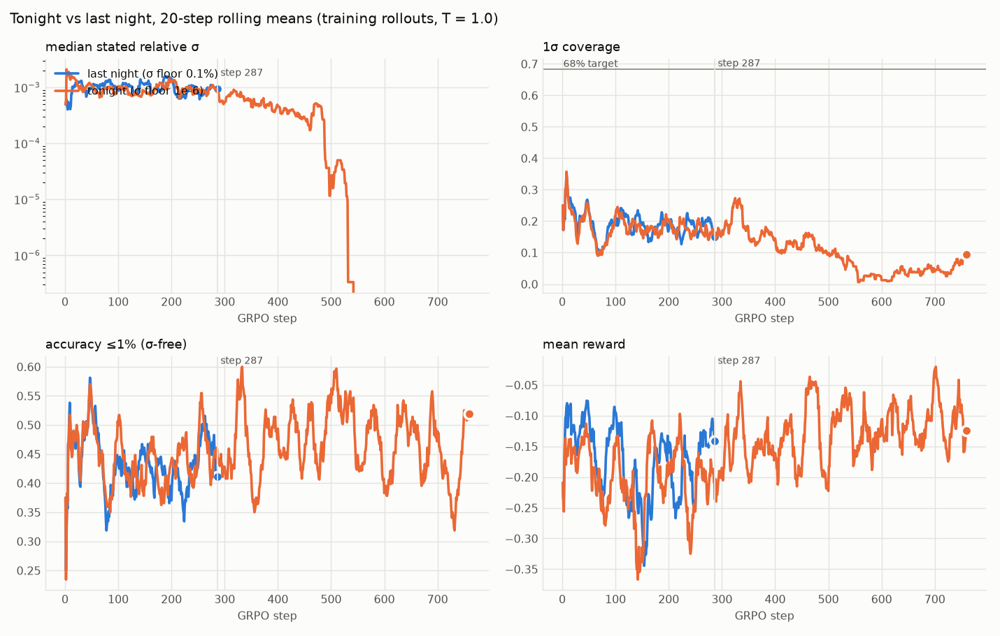

# Morning report: 2026-10-14 (Phase 3.7: σ floor removed, matched-step GRPO rerun)

**Short version.** Everything you asked for ran, and everything is committed and pushed.

**FINDINGS #6 (the answer to your question): removing the σ floor did not let RL move calibration at matched
steps, and RL does not beat post-hoc scaling.**

- **At step 287, 1σ coverage is unchanged.**
  - New RL: **14.0% (ID) / 9.5% (depth 5)**.
  - SFT-only: 15.0% / 11.5%. Last night's RL: 15.5% / 10.0%.
  - Every paired McNemar p is ≥ 0.125, and the direction is slightly worse.
- **A free post-hoc σ scale beats RL by about 20 points.**
  - One multiplier (c = 18.1), fitted on 400 training-seed problems, lifts SFT-only coverage to **35.0% /
    33.5%**.
  - That beats RL@287 by 42 / 48 problems (p < 1e-12).
  - It still falls short of 68%: matching 68% on the calibration set needs c = 585, which gives 65% / 72.5% but
    costs 0.2 in crps_log.
- **Longer training (to step 759) made σ collapse to exactly zero.**
  - After step ~550, 95–98% of training answers say "± 0".
  - The final adapter's greedy coverage falls to 11.5% / 8.1%, with 50.5% of ID answers stating σ = 0.
  - The scoring rule doesn't favour this: on those answers, σ = 1% of the value would have scored better. So it
    is a learning-dynamics failure, not verifier gaming.
- **Why, in one line:** under crps_log, σ is worth almost no reward for this policy.
  - The best global σ scale gains only +0.001 crps_log per problem.
  - σ that tracked each answer's own error would gain +0.12, but the model's σ has ~zero correlation with its
    error.
  - So the σ signal is swamped by correctness and gets credited along with it.

**Housekeeping:**
- All 5 stages done. **259 tests pass. Nothing BLOCKED.**
- GPU work ended at **07:53 IST**, 37 minutes before the 08:30 cutoff.
- Peak torch reserved memory was **7.05 GiB** (cap 7.5), with 0 OOMs and no thermal pauses.

Details are in [FINDINGS.md](FINDINGS.md) #6, [DECISIONS.md](DECISIONS.md) D38–D42 and [PROGRESS.md](PROGRESS.md).

---

## 1. What ran (all times IST)

| time | stage | commit |
|---|---|---|
| 23:35–23:41 | Verifier 1.1.0 (crps_log floor 1e-6, version bump) + 13 tests | `3d65dc1` |
| 23:42–23:46 | Stage 1: re-score last night's SFT-only / SFT+RL eval tapes under 1.1.0 | `2d3ec25` |
| 23:43–23:56 | Stage 2: SFT-only completions on 400 training-seed problems (GPU, 9.4 min) + σ-scale fit (CPU) | `9ad3768` |
| 23:52–23:57 | Stage 3: memory fix + 5-step smoke test | `faf1327` |
| 23:57–07:30 | Stage 4: overnight GRPO, 759 steps (permanent step-287 adapter saved at 02:50) | `9112529`, `0ef6ee6` |
| 07:31–07:42 | Stage 5a: eval of step 287 (primary) | `2fdbced` |
| 07:42–07:53 | Stage 5b: eval of step 759 (secondary, "longer training") | `b3c2d47` |
| 07:53–08:00 | FINDINGS #6, PROGRESS, this report | `81f2892` … |

## 2. Verifier 1.1.0 (D38, your approval of D37)

- `configs/reward.yaml` now has `version: "1.1.0"` and `scoring.crps_log_sigma_floor: 1.0e-6`.
  - `sigma_floor: 1e-3` still applies to `crps` (the spec's own floor) and `log_score`; nothing else changed.
  - Every breakdown logs `verifier_version`.
  - A config without `version` is 1.0.0 and keeps the shared floor, so every old tape still replays exactly.
- **Your conditions:**
  - All existing propriety and Monte Carlo tests pass unchanged.
  - The new test shows the reward **strictly increases** as σ rises from 0.01% to 0.1% of the value, for errors
    from 0.1% to 5%. It runs through the full `reward()` pipeline, and the same answers were exactly flat under
    1.0.0.
  - A new Monte Carlo test shows propriety at a 0.03% belief spread: below the old floor, where 1.0.0 was flat.
- **Stage 1:** `compare_verifier_1.1.0/{sft,rl}/` hold new, replayable tapes and metrics. The originals are
  untouched. Mean rewards change by less than 0.001 (at most 0.0064 on any one problem), which is itself a sign
  of how little σ is worth.

## 3. Post-hoc calibration control (D40)

- **Calibration set:** SFT-only, greedy, with the same settings as the eval.
  - 400 problems from the generator's *train* split: seeds 20,000,000–20,000,399, over the 12 training cells.
  - These seeds are disjoint from the GRPO pool, the SFT data and all eval seeds, and the code checks this.
- **Fits:**
  - **Primary:** the scale that maximizes mean crps_log, the objective RL optimizes. Result: c = 18.1.
  - **Sensitivity:** the scale that gives exactly 68.27% 1σ coverage on the calibration set. Result: c = 585.
- **A 24% blind spot:** 24% of SFT-only answers state **σ = 0** exactly. No multiplicative scale can cover those
  (first fit attempt got this wrong; fixed and tested).

| SFT-only eval | 1σ / 2σ cov ID | 1σ / 2σ cov depth 5 | mean crps_log ID / depth 5 |
|---|---|---|---|
| stated σ | 15.0 / 20.5% | 11.5 / 16.0% | −0.320 / −0.357 |
| × 18.1 (crps fit) | 35.0 / 40.5% | 33.5 / 38.0% | −0.319 / −0.354 |
| × 585 (coverage-matched) | 65.0 / 69.5% | 72.5 / 76.0% | −0.519 / −0.506 |

## 4. Memory fix (D39)

- **Cause:** on WSL, Unsloth strips `expandable_segments`, so fragmentation pushed reserved memory to 8.96 GiB
  last night while only 4.58 GiB was ever allocated.
- **Fix:** micro-batch 2 × 16 accumulation instead of 4 × 8, plus a 7.5 GiB allocator cap
  (`set_per_process_memory_fraction`).
- **Why nothing else changes:** it is the same 32-completion batch, and DAPO divides by the token count of the
  whole batch, so the gradient is identical up to float summation order. A test checks that the two YAML files
  differ only in the allowed keys.
- **Smoke test:** 6.46 GiB peak, 0 OOMs. The curriculum drew the same cells as last night for steps 1–5.
- **Full run:** 7.05 GiB peak reserved, 1 allocator retry, 0 OOMs. It ran faster than last night: 35.7 vs
  58.9 s/step.

## 5. Overnight GRPO (stage 4)

759 steps in 7 h 32 min (24,288 rollouts, replay exact). The permanent step-287 adapter is at
`permanent_checkpoints/checkpoint-287`, and the rotating checkpoints 700/750/759 are kept (all local only).
The curriculum again never unlocked energy beyond depth 2 (energy/2 EMA pass rate 0.16 at the end).
kinematics/4 unlocked only at step 590.

| training rollouts (per window) | σ = 0 share | median stated σ | 1σ cov | acc ≤1% |
|---|---|---|---|---|
| last night, steps 1–287 | 23.5–25% | 0.06–0.07% | 17.5–19% | 42–44% |
| tonight, steps 1–287 | 24–26% | 0.055–0.067% | 16.5–18.5% | 42–46% |
| tonight, steps 301–400 | 29–36% | 0.026–0.040% | 14–25% | 42–52% |
| tonight, steps 451–575 | 52 → 91% | 0 | 2–15% | 46–55% |
| tonight, steps 576–759 | 94–98% | 0 | 2–7% (14% in the last 9 steps) | 38–50% |

The σ = 0 answers are literally "± 0" in the text; it is not a parser artifact.

## 6. Eval (stage 5): frozen sets, greedy, 512 tokens, all on verifier 1.1.0

| split | model | acc ≤1% | 1σ / 2σ cov | σ = 0 answers | mean crps_log |
|---|---|---|---|---|---|
| ID | SFT-only | 38.0% | 15.0 / 20.5% | 25.5% | −0.320 |
| ID | post-hoc (c = 18.1) | 38.0% | **35.0 / 40.5%** | 25.5% | −0.319 |
| ID | last night's RL @287 | 40.0% | 15.5 / 20.0% | 27.0% | −0.275 |
| ID | **new RL @287 (primary)** | 39.5% | 14.0 / 18.5% | 27.0% | −0.282 |
| ID | new RL @759 (longer) | 41.0% | 11.5 / 16.0% | 50.5% | −0.239 |
| depth 5 | SFT-only | 31.0% | 11.5 / 16.0% | 12.0% | −0.357 |
| depth 5 | post-hoc (c = 18.1) | 31.0% | **33.5 / 38.0%** | 12.0% | −0.354 |
| depth 5 | last night's RL @287 | 31.0% | 10.0 / 15.0% | 13.5% | −0.361 |
| depth 5 | **new RL @287 (primary)** | 29.0% | 9.5 / 14.0% | 15.0% | −0.437 |
| depth 5 | new RL @759 (longer) | 31.0% | 8.1 / 13.1% | 35.9% | −0.344 |

**Paired tests, primary (step 287).** 1σ-covered counts out of 200 problems:

| comparison | ID: 1σ covered, before → after (p) | depth 5: 1σ covered, before → after (p) | other |
|---|---|---|---|
| vs SFT-only | 30 → 28 (p = 0.50) | 23 → 19 (p = 0.125) | accuracy 76 → 79 (p = 0.38) |
| vs last night's RL | 31 → 28 (p = 0.25) | 20 → 19 (p = 1.0) | accuracy 80 → 79 (p = 1.0) |
| vs post-hoc control | 70 → 28 (p = 5e-13) | 67 → 19 (p = 7e-15) | crps_log: RL better on ID (−0.282 vs −0.319, p = 0.87), worse on depth 5 (−0.437 vs −0.354, p = 0.014) |

**Secondary, longer training (step 759 vs step 287):**
- ID 1σ covered 28 → 23 (p = 0.18).
- Accuracy 79 → 82 (p = 0.45).
- Against SFT-only: accuracy 76 → 82 (p = 0.07), 1σ 30 → 23 (p = 0.065), 2σ 41 → 32 (p = 0.035, nominal).

So longer RL is trending toward slightly better accuracy and worse calibration; neither is significant after
correction.

## 7. Decisions to review

1. **D38: verifier 1.1.0.** A separate floor key, rather than lowering the shared one. That keeps the spec's
   `crps` and the log score unchanged.
2. **D40: post-hoc control design.** The crps fit is the headline, and the coverage-matched fit is a
   sensitivity row. The fit used depths 1–4 only, because training seeds can't make depth 5; the scale was
   transferred to depth 5 unchanged and held up (33.5%).
3. **D39: memory.** A hard 7.5 GiB allocator cap. If a step ever needs more than 7.5 GiB live, it OOMs instead
   of spilling. The live peak was 4.56 GiB, so the margin is large.
4. **D41: paired coverage counts failures as not covered.** With 0–1% parse failures this matches the
   headline coverage.
5. **D42: tonight's training tape is committed gzipped** (101 MB raw, over GitHub's limit). Progress commits up
   to step 400 put several raw versions (6–50 MB) into git history. I did not rewrite history.

## 8. Recommendation: what to decide next

The result is clear: **with the current reward, RL is not a calibration method for this model.**
- σ gets credit only through the whole completion's reward, which correctness dominates.
- A post-hoc scale does better for free.
- Running longer is actively harmful (the σ = 0 collapse).

My suggestions, in order:

1. **Give σ its own credit (design change, your call).** Two options:
   - **(a) Two-stage answer.** The model answers, then a second short turn asks for σ, which is scored by
     crps_log with μ fixed. σ's reward then depends only on σ. This is the cleanest option and needs no change
     to the reward rule, only to the rollout format.
   - **(b) Token-level advantage split in the GRPO loss.** The answer tokens get the group-normalized
     correctness or error advantage. The σ tokens get the group-normalized advantage of
     `crps_log(μ, σ) − crps_log(μ, σ_ref)`, whose μ-only part cancels. This is a trainer change.

   The prize is large if σ can learn to track error: an oracle σ is worth +0.12 crps_log per problem here, against
   +0.001 for any global scale.
2. **Decide what "± 0" means.** It is a legal point forecast under CRPS, but for RL it is an absorbing state
   (no σ variance in the group means no gradient). The options are to treat σ = 0 as "missing ±"
   (`parse_fail`), or to keep it and rely on (1). Either way, it is a verifier change and needs your approval.
3. **Make the σ = 0 share and 1σ coverage first-class stop and alert signals** (the spec's reward-hacking check,
   inverted). Here, step 287 is better calibrated than step 759. I'd add an alert-only rule (σ = 0 share > 50%
   over 25 steps) to the training loop, which doesn't need verifier changes.
4. **Report the post-hoc scale as the calibration baseline** in every future table. RL has to beat 35.0% / 33.5%
   coverage at equal or better crps_log.
5. **Unchanged from yesterday:** the energy family is still stuck at depth 2 (pass rate 0.16), and RL still adds
   little accuracy (ID +3 problems at step 287, +6 at step 759, neither significant). RQ1 (binary vs dense
   reward) is now testable from this starting point and is the natural next ablation.

## 9. BLOCKED / housekeeping

- **BLOCKED:** nothing.
- **Local-only artifacts (gitignored):**
  - Tonight's adapters: `permanent_checkpoints/checkpoint-287` (`lora_hash 86f7436e726bbaa5`), `final_adapter`
    (step 759, `e33c888028e2ec0a`), and checkpoints 700/750/759.
  - The raw training tape `rollouts.jsonl` (101 MB). The gzipped copy is in git.
- **Smoke-test run dir:** `results/train/smoke-overnight2-mb2/` is committed (5 steps); its checkpoint is local
  only.
