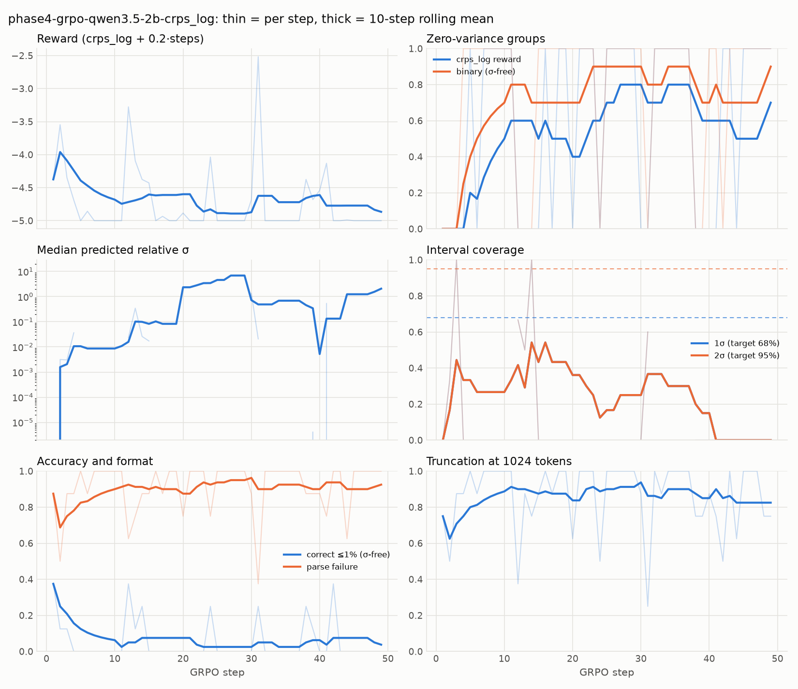

# Morning report: 2026-10-12 (Phase 3.5 + first Phase 4 run)

**Short version.** All four Phase 3.5 decisions are applied. The model probe ran on all three candidates,
and the selection rule picked **Qwen3.5-2B**. A first GRPO run (crps_log, per your > 50% rule) ran
**49 steps** before the hard deadline. It fit easily in memory (4.45 GiB device peak) but **did not learn**:
82–94% of completions hit the 1024-token cap and scored the floor. On the same 400 eval problems,
before → after is ID accuracy 13.5% → 14.0% (σ-free) and 7% → 9% (strict), with **no statistically
significant change** (paired McNemar/Wilcoxon, smallest p = 0.056).
**What you need to decide next is how to solve completion length / format before more RL** (§6).
Everything is committed and pushed (`origin/main`), 226 tests pass, nothing is BLOCKED, and all GPU work
ended before 15:45 IST.

Earlier reports: phase 1–3 details in [PROGRESS.md](PROGRESS.md), every decision in [DECISIONS.md](DECISIONS.md)
(D29–D34 are new), research results in [FINDINGS.md](FINDINGS.md) (#1, #2).

---

## 1. Phase 3.5: your decisions, applied

| decision | done | where |
|---|---|---|
| Default rule → `crps_log`; relative CRPS kept as a flag | ✓ | `configs/reward.yaml`, D29 (`50bd351`) |
| −5 failure floor for CRPS; binary floor 0 | ✓ (already implemented, now marked final) | D13 |
| Depth-1 wording fixed; generator → **1.1.0** (`1.1.0+c735a0d4`); eval sets regenerated; old tapes replayable | ✓ | D30 (`8e34524`); frozen sets in `data/eval_sets/1.1.0+c735a0d4/` with a byte-equality test; all 6 phase-3 tapes (2,368 rollouts) still replay exactly under 1.0.0 |
| FINDINGS #1: binary 100% zero-variance vs CRPS 4% | ✓ | FINDINGS.md #1 (`57f144c`). Re-scored with a truly σ-free binary rule: still 100% (48/48 groups); relative CRPS 4.2%, crps_log 0.0% |

## 2. Model probe (inference only)

Same prompt for all (v4: worked example, no σ hint), 1024 new tokens, generator 1.1.0, crps_log, explicit
decoding. Greedy: 200 ID + 200 depth-5 problems. Group: 48 ID problems × k = 8 at T = 1.0. Revisions pinned
and verified after load. Full table: `results/model_probe/summary.md`.

| model | greedy ID ≤1% / ≤2% / ≤5% / ≤10% (σ-free) | depth-5 ≤1% | truncated (greedy) | **binary zero-var** | crps_log zero-var | pass@8 | est. GRPO peak | measured inference peak (torch / device) |
|---|---|---|---|---|---|---|---|---|
| Qwen2.5-1.5B-Instruct `989aa798` | 2.5 / 3.0 / 4.0 / 5.5% | 1.0% | 42.5% | 91.7% | 2.1% | 8.3% | 3.67 GB | 4.48 / 6.84 GiB |
| Qwen2.5-Math-1.5B-Instruct `aafeb0fc` | 0 / 0 / 0 / 0% (100% parse fail) | 0% | 28.0% | 97.9% | 95.8% | 2.1% | 3.67 GB | 4.48 / 6.83 GiB |
| **Qwen3.5-2B** `15852e8c` (non-thinking) | **13.5** / 13.5 / 13.5 / 14.0% | 2.5% | 69.5% | **72.9%** | 56.2% | 27.1% | 4.27 GB | 6.92 / 7.67 GiB |

- **Selection rule → train Qwen3.5-2B.** It is the only model under the 80% binary zero-variance threshold,
  and its estimated footprint (4.27 GB) fits 6.5 GB. Binary zero-variance by depth: 25% / 75% / 100% / 92% for
  depths 1–4.
- **Qwen2.5-Math has the best physics but the wrong format** (D32). It always answers in `\boxed{}`. Read
  out-of-band (diagnostic only, not the verifier), its boxed answers are within 1% on **35% of ID / 8.5% of
  depth-5** problems (greedy), versus 13.5% / 2.5% for Qwen3.5-2B through the verifier.
- **Qwen3.5-2B is limited by length.** When it finishes it's mostly right, but 70–76% of completions
  hit 1024 tokens before `<answer>`.
- Why Qwen3.5-2B counted as "the strongest current ≤ 2B instruct": D31 (Qwen's card: non-thinking MMLU-Pro
  55.3 vs Qwen3-1.7B 40.2; LFM2.5-1.2B and granite-4.0-1b compare below Qwen3-1.7B on LiquidAI's card).
- Two fixes made along the way: Qwen3.5 ships no `generation_config.json` and names the wrong stop token
  (so generation would never stop at the end of a turn), and its sampled probe had to be re-run at batch 8
  after an OOM-retry slowdown (D33).

## 3. Phase 4: install, smoke test, first GRPO run

- **Install (4a):** unsloth 2026.10.3, trl 1.13.0, peft 0.21.2, bitsandbytes 0.50.2. Unsloth needs
  `transformers <= 5.17.0`, so the project now pins **5.17.0** (the probes used 5.19.0). Qwen3.5 worked on the
  first attempt, so no fallback model was needed.
- **Smoke test (4c, 10 steps):** **78 s/step** (step 1: 167 s compile), **peak 3.30 GiB torch / 4.17 GiB
  device-wide**, which matches the 4.27 GB estimate.
- **Run (4d):** Qwen3.5-2B, **crps_log** (binary zero-variance 72.9% > 50%), 1 prompt × 8 completions per
  step, 1024 tokens, LoRA r = 16, lr 5e-6, DAPO loss (TRL default), no KL. It stopped at the **14:55 IST hard
  deadline after 49 steps** (57 min, 69.4 s/step; your 2 h / 300-step caps didn't bind). Peak **3.29 GiB
  torch / 4.45 GiB device**. The thermal guard (checked every 5 steps, limit 87 °C) never triggered a pause; spot readings were 69–75 °C.

| steps | mean reward | zero-var (crps_log) | zero-var (binary) | accuracy ≤1% | truncated | mean tokens |
|---|---|---|---|---|---|---|
| 1–10 | −4.68 | 50% | 70% | 6.2% | 89% | 956 |
| 11–20 | −4.60 | 40% | 70% | 7.5% | 84% | 913 |
| 21–30 | −4.87 | 80% | 90% | 2.5% | 94% | 979 |
| 31–40 | −4.61 | 60% | 70% | 6.2% | 85% | 923 |
| 41–49 | −4.90 | 78% | 89% | 4.2% | 82% | 936 |

**Reading:** no learning trend. With 1 prompt per step, a step has a gradient only if at least one of its 8
completions finishes inside 1024 tokens. That happened in roughly 40% of steps, and 49 steps was far too few
to change the model's length habit. Predicted σ and coverage are too sparse per step to read: only 0–3
completions per step even reach `<answer>`.
Artifacts: `results/train/phase4-grpo-qwen3.5-2b-crps_log/` (train_metrics.jsonl, rollouts.jsonl with 392
rollouts that replay exactly, summary.json, training_curve.png). The adapter and checkpoint-49 are local only
(gitignored).

## 4. Before / after eval (4e)

Same eval sets and settings as the "before" probe: 200 ID + 200 depth-5 problems (generator 1.1.0), prompt v4,
greedy, 1024 tokens, transformers 5.19.0. The adapter (`lora_hash 5efe8a51708c3eca`) is merged into the bf16
base. The eval tape replays exactly. Eval peak 6.30 GiB torch / 7.67 GiB device; finished 15:22 IST.

| split | metric | before (Qwen3.5-2B base) | after (49 GRPO steps) | paired test |
|---|---|---|---|---|
| ID | accuracy ≤1% / ≤2% / ≤5% / ≤10% (σ-free) | 13.5 / 13.5 / 13.5 / 14.0% | 14.0 / 14.0 / 14.0 / 14.5% | McNemar p = 1.00 (≤1%) |
| ID | accuracy ≤1%, strict (± required, crps_log) | 7.0% (14) | 9.0% (18) | p = 0.48 |
| ID | parse failures / of which truncated at 1024 | 82.0% / 69.5% | 78.0% / 66.5% | p = 0.20 / 0.39 |
| ID | unit mismatch / missing ± | 2.5% / 11.5% | 4.5% / 10.5% | |
| ID | 1σ / 2σ coverage (n with σ: 31 → 35) | 29.0% / 35.5% | 37.1% / 37.1% | |
| ID | median stated relative σ | 0.014% | 0.07% | |
| ID | mean reward (crps_log) | −4.41 | −4.29 | Wilcoxon p = 0.47 |
| depth 5 | accuracy ≤1% / ≤10% (σ-free) | 2.5% / 2.5% | 2.5% / 4.5% | p = 1.00 (≤1%) |
| depth 5 | parse failures / truncated | 90.0% / 87.5% | 85.5% / 84.5% | p = 0.09 / 0.33 |
| depth 5 | 1σ / 2σ coverage | 6.2% / 12.5% | 19.2% / 23.1% | |
| depth 5 | mean reward (crps_log) | −4.69 | −4.48 | Wilcoxon p = 0.056 |

**Reading: no statistically significant change.** Every metric moved slightly in the right direction
(a few more finished answers, slightly higher reward), but the paired tests on the same problems put all of
it within noise (smallest p = 0.056). 49 steps × 8 completions at lr 5e-6 barely moves a LoRA. Coverage is
computed on only 16–35 answers per split and stays far below the 68% / 95% targets: stated σ is still
~100× too small. Files: `results/train/phase4-grpo-qwen3.5-2b-crps_log/{eval_greedy/,before_after.json,
before_after_significance.json}`; the test is `scripts/paired_tests.py`.

## 5. Decisions to review (new since your last read)

1. **D34: how phase 4 was run.** Mainly: 1 prompt per step (cheapest; also the reason for the per-step
   variance); TRL's default DAPO loss; LoRA not on the Gated-DeltaNet projections; the transformers 5.17 pin
   for Unsloth (eval run with a 5.19 overlay for comparability).
2. **D31: candidate choice and probe design.** All models use the same prompt and our explicit decoding,
   not each card's recommended sampling. The 6.5 GB budget is read as decimal GB.
3. **D32: Qwen2.5-Math scored on format as-is.** The verifier was not changed; the `\boxed{}` diagnostic is
   reported but not used for selection.
4. **D33: Qwen3.5 group probe re-run at batch 8.** Same problems/seed, different random stream.
5. **D30: generator 1.1.0 re-draws every eval problem** (the version seeds the RNG), not just the depth-1
   text. 1.0.0 and 1.1.0 numbers are on different, identically distributed problem sets.

## 6. Recommendation: what to decide next

**The bottleneck is no longer the reward. It is that the policy rarely produces a finished, well-formed
answer inside the token budget.** Every RL signal flows through completions that end with `<answer>`.
Qwen3.5-2B truncates 70–90% of the time at 1024 tokens; Qwen2.5-Math finishes but in the wrong format.
Note too that the spec's GRPO budget is **512** tokens (CLAUDE.md), and all of tonight's work used 1024 per
your brief. At 512, every candidate would be worse.

What I'd decide, in order:

1. **Approve a short Phase 3.6 SFT warm-up** on generator-written *concise* solutions: SI conversion, one line
   per chain step, `<steps>`, `<answer>`, aiming at ≤ 300–400 tokens. Mask the σ tokens out of the SFT loss so
   σ is learned only from the proper scoring rule in RL. This teaches format and brevity, which are exactly
   the two failure modes measured. A draft is in [PHASE3_6_PLAN.md](PHASE3_6_PLAN.md) (not approved, not run).
2. **Pick the base model for that warm-up.** Qwen3.5-2B (passes selection today, follows the format, fits:
   4.45 GiB in training) or **Qwen2.5-Math-1.5B** (best latent physics, 35% ID within 1%; it only lacks the
   format, which SFT fixes cheaply; smaller and faster). My suggestion is a 30-minute SFT on each, then
   re-run the existing group probe (`uv run python -m physcal.eval.model_probe --only <label> --part group`)
   and let the binary zero-variance number decide.
3. **Decide the completion budget explicitly:** keep the spec's 512 (needs SFT for brevity), or adopt 1024
   (memory is fine: 4.45 GiB peak; steps take ~70 s).
4. **Then re-run phase 4** with 4 prompts × 8 completions per step (less step-to-step variance), a curriculum
   that starts at depths 1–2 (where Qwen3.5's zero-variance is 25–75%), and a multi-hour budget. Keep binary
   as the RQ1 comparison arm only once it has non-zero variance; FINDINGS #1 already shows it gets no signal
   from a cold start.

## 7. BLOCKED / housekeeping

- **BLOCKED:** nothing. The install worked first time, and no model switch was needed.
- `~/.local/bin/python3.11` (a symlink created by `uv python install` yesterday) is still there. It's
  harmless; remove it with `rm ~/.local/bin/python3.11` if you like.
- The project now pins `transformers==5.17.0` because of Unsloth. Inference-only runs can still use 5.19 via
  `uv run --with transformers==5.19.0 ...`.
- Large local-only artifacts (gitignored): the LoRA adapter and checkpoint in
  `results/train/phase4-grpo-qwen3.5-2b-crps_log/{final_adapter,checkpoints}/`, and the model weights in
  `.cache/huggingface/`.
