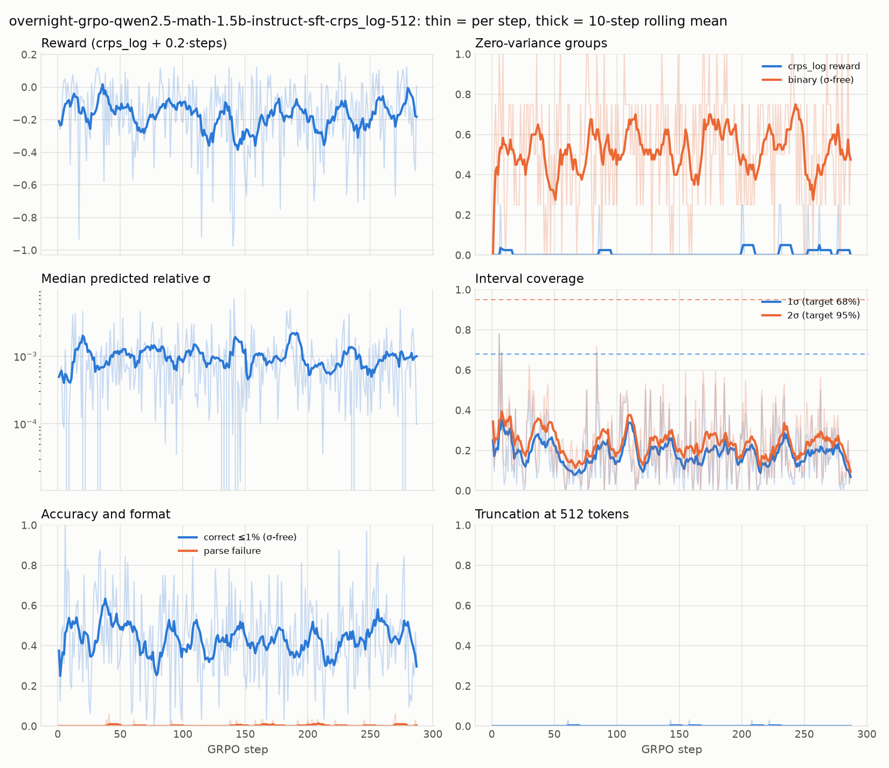

# Morning report: 2026-10-13 (Phase 3.6: SFT warm-up A/B + overnight GRPO)

**Short version.** Your approved Phase 3.6 ran end to end, and everything is committed and pushed.

- **The SFT warm-up worked.** 30 minutes of σ-masked SFT on generator solutions took Qwen2.5-Math-1.5B from
  **0% → 38%** within-1% accuracy on the in-distribution (ID) eval, and from **0% → 31% on depth 5**. Parse
  failures went from 100% to 0%.
- **The A/B went to Qwen2.5-Math-1.5B + SFT, but it was effectively a tie** (binary zero-variance 56.2% vs 60.4%,
  27 vs 29 groups of 48). Its truncation at 512 tokens is 0%, so the GRPO budget was **512**.
- **The overnight GRPO** (crps_log, 4 × 8, EMA curriculum from depths 1–2) ran **287 steps** before the 06:30
  hard stop.
- **What RL added on top of SFT is small and not significant:**
  - ID 38.0% → 40.0% (4 problems flipped to correct, 0 flipped to wrong, McNemar p = 0.125).
  - Mean reward +0.046 (Wilcoxon p = 0.018 nominal; not significant after multiple-comparison correction).
  - Depth 5 unchanged.
  - **Calibration did not improve:** 1σ coverage ~15% against the 68% target.
- I think I found a likely reason for the calibration result: the 0.1% σ floor in the scoring rule (D37). It's
  your call, because fixing it means changing the verifier, which you said not to touch.

238 tests pass, nothing is BLOCKED, and all GPU work ended at 07:07 IST. Full details are in
[FINDINGS.md](FINDINGS.md) #4 and #5, [DECISIONS.md](DECISIONS.md) D35–D37, and
[PROGRESS.md](PROGRESS.md).

---

## 1. What ran (all times IST)

| time | stage | commit |
|---|---|---|
| 00:25–00:57 | SFT code (data builder with σ masking, trainer, merge, EMA curriculum, 3-way compare) + tests | `0e5c97c`, `ab8e79e` |
| 00:27–00:57 | SFT Qwen3.5-2B: 262 steps / 2,096 examples, loss 0.59 → 0.05 | `abe84f1` |
| 00:59–01:30 | SFT Qwen2.5-Math-1.5B: 325 steps / 2,600 examples, loss 0.64 → 0.06 | `eee48d5` |
| 01:31–01:48 | Merges (CPU) + the unchanged k = 8 group probe on both SFT'd models → A/B decision | `a2d8bb2` |
| 01:49–06:30 | Overnight GRPO, 287 steps (checkpoints pushed at 50/100/150/200/250) | `79afcc3` … `186209d` |
| 06:31–07:07 | Final eval: raw base / SFT-only / SFT + RL, plus paired tests | this commit |

SFT data came only from training seeds 10,000,000–10,002,999 (12 training cells). No eval seeds, no depth 5 and
no held-out family were used, and `build_examples` refuses eval-range seeds. A test runs 240 SFT targets through
our own verifier: all correct, with full step credit. GRPO problems used training seeds 0.., cell-major.

## 2. SFT A/B (FINDINGS #4)

The unchanged group probe (48 ID problems, k = 8, T = 1.0, prompt v4, 1024 tokens):

| model | binary zero-var | crps_log zero-var | pass@8 | pass rate | parse fail | truncated | tokens | sampled acc ≤1% | 1σ cov |
|---|---|---|---|---|---|---|---|---|---|
| Qwen3.5-2B base | 72.9% | 56.2% | 27.1% | 7.0% | 87.8% | 76.3% | 885 | 7.0% | 27.9% |
| Qwen3.5-2B + SFT | 60.4% | 0.0% | 60.4% | 35.7% | 0.3% | 0.3% | 205 | 35.7% | 30.5% |
| Qwen2.5-Math base | 97.9% | 95.8% | 2.1% | 0.3% | 99.5% | 17.2% | 708 | 0.3% | – |
| **Qwen2.5-Math + SFT** | **56.2%** | 0.0% | 58.3% | 36.2% | 0.3% | **0.0%** | 197 | 36.2% | 20.2% |

- **Winner by your rule: Qwen2.5-Math + SFT.** Note that 27 vs 29 zero-variance groups is within noise.
- **Budget: 512** (0% truncation at 512, under the 20% threshold).

## 3. Overnight GRPO

Qwen2.5-Math-1.5B + SFT (merged), fresh LoRA r = 16, crps_log + 0.2·steps, **4 prompts × 8 completions per
step**, 512 tokens, lr 5e-6, DAPO loss (TRL default), no KL. EMA curriculum: w = p(1−p) + 0.02, starting at
depths 1–2, with depth d+1 unlocking at an EMA pass rate ≥ 0.5 after ≥ 8 groups (D36). Hard stop 06:30 IST;
checkpoints every 50 steps, keeping 3.

- **287 steps** in 4 h 42 min (**58.9 s/step**). Peak **4.58 GiB** torch-allocated / **7.73 GiB** device-wide.
  The guard never paused (it checked every 2 steps; the GPU ran at 72–74 °C).
  - Torch's *reserved* memory peaked at 8.96 GiB, above the 8 GiB of VRAM, so WSL probably spilled into shared
    system memory at some point. Worth knowing before longer runs.
- **Curriculum:**
  - Unlocked dynamics/3 (after 56 groups), dynamics/4 (136), kinematics/3 (180), kinematics/4 (256).
  - **Energy never left depths 1–2**: energy/2's EMA pass rate ended at 0.16.
  - Final EMA pass rates: dynamics 0.85 / 0.59 / 0.56 / 0.24; kinematics 0.65 / 0.34 / 0.18 / 0.24;
    energy 0.41 / 0.16 (depths 1–4).
- **Checkpoints kept:** 200, 250, 287. The final adapter has `lora_hash 8b4b2376bf92206f`. All of these are local
  only.

| steps | mean reward | zero-var (crps_log) | zero-var (binary) | accuracy ≤1% | median stated rel. σ | 1σ cov |
|---|---|---|---|---|---|---|
| 1–50 | −0.118 | 0.5% | 48% | 48% | 0.074% | 23% |
| 51–100 | −0.154 | 0.5% | 51% | 41% | 0.074% | 15% |
| 101–150 | −0.235 | 0.0% | 55% | 44% | 0.078% | 21% |
| 151–200 | −0.185 | 0.5% | 56% | 41% | 0.077% | 18% |
| 201–250 | −0.211 | 1.5% | 55% | 42% | 0.063% | 18% |
| 251–287 | −0.129 | 2.0% | 49% | 45% | 0.072% | 18% |

**Reading:** almost every step had a gradient (crps_log zero-variance ≈ 0%, against 40–80% in Phase 4), so
the reward design did its job. The training reward isn't comparable across the run, because the curriculum
moved toward harder cells. Stated σ never moved (see §5, D37).

## 4. Final eval: raw base vs SFT-only vs SFT + RL (FINDINGS #5)

Same frozen eval sets for all three (200 ID + 200 depth-5, generator `1.1.0+c735a0d4`), prompt v4, greedy,
**512 tokens**, all loaded text-only, transformers 5.17. Every eval tape replays exactly.

| split | model | acc ≤1% | ≤2% | ≤5% | ≤10% | parse fail | 1σ / 2σ cov | median rel. σ | mean reward |
|---|---|---|---|---|---|---|---|---|---|
| ID | raw base | 0.0% | 0.0% | 0.0% | 0.0% | 100% | – | – | −5.000 |
| ID | SFT only | 38.0% | 44.5% | 60.5% | 67.5% | 0% | 15.0 / 20.5% | 0.050% | −0.224 |
| ID | **SFT + RL** | **40.0%** | **46.5%** | 60.5% | **71.0%** | 0% | 15.5 / 20.0% | 0.042% | **−0.177** |
| depth 5 | raw base | 0.0% | 0.0% | 0.0% | 0.0% | 100% | – | – | −5.000 |
| depth 5 | SFT only | 31.0% | 40.0% | 51.0% | 60.0% | 0% | 11.5 / 16.0% | 0.081% | −0.215 |
| depth 5 | SFT + RL | 31.0% | 39.5% | 51.0% | 59.5% | 0% | 10.0 / 15.0% | 0.064% | −0.220 |

**Paired tests (same problems, greedy):**

| comparison | split | strict ≤1% correct: before → after (only-after / only-before) | McNemar p | reward Δ | Wilcoxon p |
|---|---|---|---|---|---|
| **RL vs SFT-only** (what RL added) | ID | 76 → 80 (4 / 0) | 0.125 | +0.046 | 0.018 |
| **RL vs SFT-only** | depth 5 | 62 → 62 (4 / 4) | 1.0 | −0.005 | 0.37 |
| RL vs raw base | ID / depth 5 | 0 → 80 / 0 → 62 | < 1e-18 | +4.8 | < 1e-33 |
| SFT vs raw base | ID / depth 5 | 0 → 76 / 0 → 62 | < 1e-18 | +4.8 | < 1e-33 |

**Reading:**
- **RL added little, and nothing that is statistically solid.** The ID gain all points one way (4 flips to
  correct, none to wrong), but four discordant pairs can't reach p < 0.05. The reward p = 0.018 is one of 8
  RL-vs-SFT tests, so it isn't significant after correction. Depth 5 is unchanged, and so is calibration.
- Per depth, the ID gain sits at depth 4 (22% → 28%).
- By family: energy is weak in every model (ID 14–16%, depth 5 1.5–3%), while dynamics and kinematics reach
  38–62%.

## 5. Decisions to review

1. **D37: the σ floor (please read).** The scoring rule treats every relative σ below 0.1% as exactly 0.1%. The
   SFT'd policy states σ ≈ 0.05% (median), so crps_log is **flat in σ** wherever the policy sits, and RL got
   essentially no signal to widen σ. CRPS stays finite as σ → 0, so the floor only matters for the log score.
   **Recommendation:** lower `sigma_floor` to ~1e-6 for the CRPS rules (a verifier/config change, which I didn't
   make) before the next RL run, and re-score old tapes with `rescore`.
2. **D36: A/B and GRPO design.** Equal wall clock rather than equal examples; the curriculum unlock threshold
   (0.5, my choice); 4 × 8 per step; and the final comparison at 512 tokens (so its raw-base numbers differ from
   the 1024-token probe).
3. **D35: SFT data and masking.** The σ number is masked; `±`, the unit and the end-of-turn token are trained.
   The target text holds a placeholder σ (2%) that the model is never trained to produce.

## 6. Recommendation: what to decide next

The SFT'd Qwen2.5-Math is now a solid base: 38% / 31% accuracy, 0% format failures, ~200-token answers, and
nearly every GRPO group has variance. The open problem is that **RL with this reward isn't yet improving accuracy
or calibration measurably.** My suggestions, in order:

1. **Fix the σ floor for crps_log (D37).** This is the most likely reason calibration (RQ2) didn't move, and it is
   a one-line config change plus a reward-config version bump. Approve or reject.
2. **Give RL a real budget and a stronger step.** Try lr 1e-5–2e-5 (5e-6 barely moves a LoRA in 287 steps) and run
   for several nights, or rent a GPU for the run. Measure against the SFT-only checkpoint again with the same
   paired tests; that comparison is now the fixed yardstick.
3. **Fix the energy family before blaming RL.** It sits at 14–16% even after SFT, and the curriculum never
   unlocked energy/3. Check the SFT targets for energy (the sqrt-heavy formulas like v1 = sqrt(2gh) and
   v2² = v1² − 2μgL) and whether 30 min of SFT was too little for it. A short energy-weighted SFT top-up may help.
4. **RQ1 (binary vs dense reward) is now testable.** From the SFT'd base, binary groups have variance about 45% of
   the time, so a binary-reward arm with the same seeds and budget is meaningful. It's the next ablation once (1)
   and (2) are settled.

## 7. BLOCKED / housekeeping

- **BLOCKED:** nothing.
- Large local-only artifacts (gitignored):
  - SFT adapters and merged models: `results/sft/*/{adapter,merged}`, ~3–4 GB each.
  - GRPO checkpoints and final adapter: `results/train/overnight-*/{checkpoints,final_adapter}`.
- The project pins `transformers==5.17.0` (needed by Unsloth). The `~/.local/bin/python3.11` symlink from the
  first night is still there (`rm ~/.local/bin/python3.11`).
